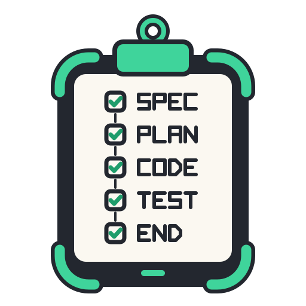
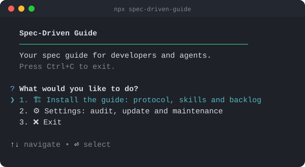

<!-- prettier-ignore-start -->
<div align="center">
  
  <h1 align="center">Spec-Driven Guide</h1>
  <p align="center">
    Your spec guide for developers and agents.<br>
    <a href="README.pt-BR.md">Versão em Português (Brasil)</a>
  </p>
  <p align="center">
    Read it live at <a href="https://specdrivenguide.org">specdrivenguide.org</a>
  </p>
  <a href="https://www.npmjs.com/package/spec-driven-guide"></a>
  <a href="https://www.npmjs.com/package/spec-driven-guide"></a>
  <a href="https://github.com/thiagocajadev/spec-driven-guide/actions/workflows/ci.yml"></a>
  <a href="https://nodejs.org"></a>
  <a href="./LICENSE"></a>
  <a href="https://agents.md"></a>
  <a href="CHANGELOG.md"></a>
</div>
<!-- prettier-ignore-end -->

<br>

Spec-Driven Guide (SDG) is a guide for working with AI agents. `npx spec-driven-guide` installs a set of markdown instruction files into your project, and the agent you already use (Claude Code, Hermes Agent, Codex, Cursor, Copilot and others) reads them and runs every task through the same five phases: SPEC, PLAN, CODE, TEST and END. You make the decisions, and the agent follows the process the guide lays out.

A developer meeting the guide for the first time reads from the top: Thiago and Cadija walk through the cycle, and Quick Start installs it. A contributor changing the instruction set reads from What Gets Installed down, where every generated file is named and pointed at its source.

<!-- prettier-ignore-start -->
<table>
  <tr>
    <td align="center" width="50%">
      <br>
      <strong>Thiago</strong>, the developer<br>
      Decides what to build and approves each step.
    </td>
    <td align="center" width="50%">
      <br>
      <strong>Cadija</strong>, the “secret” agent<br>
      Follows the guide: writes the spec, plans, codes and tests, and stops at every gate.
    </td>
  </tr>
</table>
<!-- prettier-ignore-end -->

<details>
<summary><strong>Fundamental concepts</strong></summary>

| Concept            | What it is                                                                                                                                                                                                                      |
| :----------------- | :------------------------------------------------------------------------------------------------------------------------------------------------------------------------------------------------------------------------------ |
| **Cycle**          | One unit of work, opened by a prefix (`feat:`, `fix:`, `docs:`, `audit:`, `land:`) and closed by `end:`                                                                                                                         |
| **Phase**          | One of the five steps a cycle runs through: SPEC, PLAN, CODE, TEST, END                                                                                                                                                         |
| **Wave**           | In a cycle that takes a broad request, a group of PLAN tasks that touch the same files, so each file is edited once; each wave ends with the tests green                                                                        |
| **Skill**          | A self-contained ruleset in `.ai/kit/skills/`, loaded only when the cycle's domain calls for it                                                                                                                                 |
| **Flavor**         | The architectural shape of the project, chosen at install: vertical slice, MVC, lite, or legacy                                                                                                                                 |
| **Work Checklist** | The Form items in `code-style.md`: the shape the code takes from its first line, verified at TEST                                                                                                                               |
| **Backlog**        | `.ai/backlog/`, what you and the agent write about this project: brief, stack, patterns, failures and the task queue. Versioned, so the team reads it                                                                           |
| **Kit**            | `.ai/kit/`, what the CLI installs: skills, protocol, commands and tooling. Rewritten on every install and restored from the manifest, so it stays out of git                                                                    |
| **Harness**        | Everything around the model: the guides that steer it before it acts, the sensors that check it after, and the memory it carries. SDG is the portable layer of it; Claude Code, Hermes Agent or Codex is the runtime it installs into |

</details>

## A guide, without the bureaucracy

SDG is a flexible guide. The protocol, the phases and the checks live in the instruction files, so you write one line with a prefix and the agent runs the process. There is no folder of spec documents to maintain and no template to fill in for a typo.

**The spec scales with the demand. The gates do not.** A typo earns three lines; a new domain earns a contract. This is the balance the guide exists for: the engineering that changes the outcome, without the ceremony that makes a protocol get skipped.

Avoid AI slop: everything the agent writes has a reason to exist.

## Start with a prefix

Instruct the agent the way you would write a commit message.

| How you ask         | What you type                                                     | What comes back                                                                                                |
| :------------------ | :---------------------------------------------------------------- | :------------------------------------------------------------------------------------------------------------- |
| ✅ A prefix         | `fix:` login accepts an empty password                            | The agent writes the spec, stops for your approval, then plans, codes and tests inside the same cycle          |
| A hand-written spec | contract, acceptance criteria and edge cases, written out by hand | It works well. Detail helps, and the agent can write that detail with you                                      |
| ❌ A loose ask      | `fix the login`                                                   | The agent guesses the scope and starts typing. You find out what it decided by reviewing everything afterwards |

The agent proposes the SPEC from the context it already holds about the project, and you align it together before any code. Where there is risk, spell out as much detail as you can.

## SPEC and PLAN come first

<!-- prettier-ignore-start -->
<p align="center">
  
  
</p>
<!-- prettier-ignore-end -->

SPEC and PLAN carry the most weight in the cycle, and both happen before any code.

- **SPEC**: the agent narrows the request down to what will become a feature, a system or a fix. It writes the goal, the contract and the checklist that says when the work is done, and asks the questions only you can answer.
- **PLAN**: the agent turns that agreement into small tasks in order, each one followable on its own.

At both, the agent stops for your approval, so it does not build on a guess. Skip them and the agent is more likely to take a doubtful path: the agent fills the gaps with its own reading, and you meet that reading in review, after the code exists. You fix a wrong reading caught in the SPEC by editing one paragraph.

The habit works outside code too. A business process, a product launch or a production plan goes through the same two steps: agree on what and why, then on the ordered steps. What changes is what comes after the plan.

## The cycle as a conversation

A `feat:` cycle, as Thiago and Cadija run it. Each ⏸ is a stop where Cadija waits for Thiago.

<!-- prettier-ignore-start -->

| Phase | | Message |
| :---- | :-: | :------ |
| |  | `feat: sign in with Google` |
| SPEC |  | Hi, Thiago! I read the project context and wrote the SPEC: goal, contract and verification checklist. Approve it before I plan? ⏸ |
| |  | Approved, Cadija. Go ahead and plan. |
| PLAN |  | The plan is three small tasks, in order. Shall we get to the code? ⏸ |
| |  | Go ahead. |
| CODE |  | Programming task by task, following the plan. |
| TEST |  | Checklist verified, tests and lint passing. Will you review it? ⏸ |
| |  | `end:` reviewed, it does what we agreed. |
| END |  | Changelog and backlog are updated. Shall I commit? ⏸ |
| |  | Approved, you can commit. |
| |  | Committed. Cycle closed, see you in the next session. |

<!-- prettier-ignore-end -->

The same conversation plays phase by phase at [specdrivenguide.org](https://specdrivenguide.org).

<details>
<summary><strong>What the instruction set covers</strong></summary>

- **Working protocol**: a 5-phase cycle (SPEC → PLAN → CODE → TEST → END) with Form items verified at TEST and a 3-strike Circuit Breaker that stops regression loops. The agent stops for you at SPEC, at PLAN, after TEST and before the commit. A broad request is planned in waves, groups of tasks that share files, each closed with the tests green.

- **Fresh-context review**: before the TEST stop, an `[M]` or `[L]` change is read by a second reader that gets the SPEC and the diff but not the conversation, and reports fidelity to the SPEC and code quality apart.

- **Code style and quality gates**: one `WorkChecklist` in `code-style.md`, whose Form items are verified at TEST and wired to the narrative heuristics in `governance.mjs`. Before writing, the YAGNI ladder asks whether the code needs to exist, whether the codebase, the standard library or an installed dependency already has it, and whether a one-liner does it. Validation at trust boundaries, data-loss handling, security controls and accessibility are never cut.

- **Skills, on-demand**: self-contained skill units loaded only when the cycle needs them, covering code style, testing, security, API design, data access, observability, CI/CD, cloud, SQL style, UI/UX, review, performance, domain modeling, versioning, and README writing.

- **Versioning, as a skill**: `versioning.md` owns the commit shape and the table that derives the version from the commit types, so the number is computed from the commits instead of picked by hand. It also declares the two release modes: `derived`, where CI computes the version and generates the changelog from the commit bodies, and `manual`, where the bump runs locally and the release commit carries the number. Phase END loads it on every cycle.

- **Dynamic stack context**: the `land:` cycle elicits your languages and versions and writes `.ai/backlog/stack.md`, which Phase CODE reads as the single source of truth. No static idiom catalog to maintain.

- **Any-agent compatible**: one canonical `AGENTS.md` at the repo root, which Claude Code, Hermes Agent, Codex, Cursor, Copilot, Grok, Windsurf, OpenCode and most other agents read natively. A file you wrote yourself is never overwritten.

- **Memory across sessions**: `.ai/backlog/` persists the project brief, stack, task state, and accumulated team knowledge. An Impact Map lists the files the active cycle touches, what imports them and the tests at risk.

- **Inert tooling catalog**: a bundle copied into `.ai/kit/tooling/` with nothing wired by default. No `.husky/` created, no devDep installed. Activate on demand. It carries `git-guard`, a hook that refuses `git push` and `git reset --hard` from the agent, and a `.gitattributes` and `.editorconfig` pair that agree on line endings. The one write outside `.ai/`: on a Node project, `init` adds `scripts/bump.mjs` and a `bump` script to `package.json`, which `--no-bump` skips.

</details>

---

## Quick Start

Requires a current **Node.js LTS**. The minimum is `engines.node` in `package.json`, the line the CLI is built and tested on.

```bash
npx spec-driven-guide
```

<p align="left">
  
</p>

The interactive wizard guides you through selecting an architectural flavor. Stack discovery (languages + versions) happens later via the `land:` cycle. It stays out of install so the developer can declare it deliberately, once the project brief is clear.

<details>
<summary><strong>Non-interactive install</strong></summary>

```bash
# Zero-prompt install (lite flavor + placeholder stack.md)
npx spec-driven-guide init --quick

# Vertical Slice, any stack
npx spec-driven-guide init --flavor vertical-slice

# MVC, any stack
npx spec-driven-guide init --flavor mvc
```

</details>

After install, open the agent chat and run `land: <vision>`. The agent elicits the stack, writes `.ai/backlog/stack.md`, and seeds the backlog.

---

## What Gets Installed

`AGENTS.md` is a minimal router and the one file always in context: it names every skill and loads each on demand. `workflow.md` (the 5-phase protocol) loads when a cycle starts, and everything else only when the cycle needs it.

Claude Code, Hermes Agent, Codex, Cursor, Copilot and most other agents read the root `AGENTS.md` natively, so nothing else is written beside it. The few that need one line of configuration are listed in "Using with other agents" below.

> **Cloning a project that already uses SDG?** `.ai/kit/` is not in git. Run `npx spec-driven-guide restore` once after the clone: it rebuilds the kit from the committed manifest, at the pinned version. `AGENTS.md` tells the agent the same when the kit is missing.

<details>
<summary><strong>Full tree written by <code>init</code></strong></summary>

```
your-project/
├── AGENTS.md                    ← Main entry point + skill registry, read natively by the agents
├── .ai/
│   ├── .sdg-manifest.json       ← The installed version and one hash per file. Committed
│   ├── backlog/                 ← You and the agent write it. Committed
│   │   ├── context.md           ← Project brief: vision, decisions, current state
│   │   ├── stack.md             ← Languages, runtimes and versions, declared by `land:`
│   │   ├── learned.md           ← Patterns that worked
│   │   ├── troubleshoot.md      ← Failures and their root cause
│   │   ├── tasks.md             ← The queue, and the record of what closed
│   │   └── session.md           ← Where this cycle stopped. Gitignored
│   └── kit/                     ← The CLI writes it, and rewrites it on every install. Gitignored
│       ├── skills/              ← Engineering skills, loaded on demand per cycle phase
│       ├── instructions/        ← Working protocol, flavor, delivery competency
│       ├── commands/            ← Cycle commands (feat/fix/docs/audit/land/end)
│       └── tooling/             ← Lint rules, hooks, release scripts. Nothing wired by default
```

</details>

> For a detailed breakdown of each file's role, see [Project Structure](docs/reference/PROJECT-STRUCTURE.md).

---

## How the Protocol Works

When you prefix a message to the agent, it enters the corresponding cycle:

| Trigger                        | Cycle           | What happens                                                                                                               |
| :----------------------------- | :-------------- | :------------------------------------------------------------------------------------------------------------------------- |
| `land: <your vision here>`     | First contact   | Define your project's vision and scope before writing the first line                                                       |
| `feat: <describe the feature>` | Feature         | Walk through SPEC → PLAN → CODE → TEST → END for any new feature                                                           |
| `fix: <describe the problem>`  | Bug fix         | Diagnose the root cause, fix it, and confirm nothing else broke                                                            |
| `docs: <what to document>`     | Documentation   | Write ADRs, changelogs, and technical specs with the right template                                                        |
| `audit: <scope to audit>`      | Audit           | Check whether the governance rules are applied to the project and get back a correction plan                               |
| `end: <optional instruction>`  | Close the cycle | Summarize what was done, update the changelog, and commit. Also recovers a cycle if the agent loses track mid-conversation |
| No prefix                      | n/a             | Agent asks: "land, feat, fix, docs, or audit?", then proceeds                                                              |

The agent **stops and waits for you** four times:

1. At SPEC, before any plan.
2. At PLAN, before any code.
3. After TEST, where it reports what it verified and you settle the last details. Your `end:` opens END.
4. Before the commit, which waits for your approval of the message.

```
  SPEC    the contract        what and why, in writing      ⏸  you approve
   │
  PLAN    the strategy        ordered, followable tasks     ⏸  you approve
   │
  CODE    the execution       the plan, nothing more
   │
  TEST    the verification    built matches agreed          ⏸  you review, then end:
   │
  END     the delivery        changelog, backlog, commit    ⏸  you approve the commit
```

For each phase, its rules and a diagram of the gates and loops, see [Spec-Driven Guide](docs/concepts/SPEC-DRIVEN-GUIDE.md).

---

## Guardrails

The protocol guards ten points of the cycle, so you are not the one catching these in review. Most of them are advisory: text the model reads and follows. The rest have a check outside the model that refuses, named in the last column.

<details>
<summary><strong>The ten guardrails</strong></summary>

| Guardrail                    | What it prevents                                                                     | Enforced by                                      |
| :--------------------------- | :----------------------------------------------------------------------------------- | :----------------------------------------------- |
| **Prefix required**          | A cycle guessed from a loose ask. No prefix, the agent asks which one                | advisory                                         |
| **Mid-cycle classification** | A follow-up message silently reopening the cycle as a new one                        | advisory                                         |
| **Assumptions stated**       | An unstated reading shipped as the request. Where two readings diverge, it asks      | advisory                                         |
| **SPEC and PLAN gates**      | Code written before you agreed to the contract                                       | advisory                                         |
| **Form check**               | Code that drifts from the standards reaching review                                  | `audit` Code Style check and the ESLint rules    |
| **Scope lock**               | The refactor nobody asked for, riding along with the fix                             | advisory                                         |
| **Blocker surface**          | A workaround invented in silence instead of a question asked out loud                | advisory                                         |
| **Circuit Breaker**          | The loop: 3 failed TESTs, 3 identical errors, or 3 turns without progress, then stop | advisory; a Stop hook can cap continuations      |
| **Commit gate**              | A commit you never approved, or a push nobody reviewed                               | `git-guard` hook and an `ask` permission, if set |
| **Evidence**                 | A claim about your codebase asserted from memory instead of from a file it read      | advisory                                         |

`git-guard` and the permission are not wired by `init`. The recipe is in [`tooling/README.md`](src/assets/tooling/README.md), installed as `.ai/kit/tooling/README.md`.

</details>

**Evidence** is the one aimed straight at hallucination: a statement about your repository is grounded in a file read this session and carries its `file:line`, or it ships marked unverified. Absent means unverified, and "I did not check" is a cheap, valid answer.

**What none of this does.** No instruction stops a model from being confident. The guardrails narrow where confidence can do damage and make an ungrounded claim visibly irregular. The checks that hold on their own are mechanical: the tests, the linter, `audit:`, the hooks.

---

## Architectural Flavors

Select the flavor that matches your project's structure:

| Flavor           | Pattern                                 | Use when                     |
| :--------------- | :-------------------------------------- | :--------------------------- |
| `vertical-slice` | Feature-driven vertical cuts            | Monorepo or domain-heavy API |
| `mvc`            | Classic layered (Model-View-Controller) | Standard REST service        |
| `lite`           | Minimal scaffold                        | Scripts, CLIs, utilities     |
| `legacy`         | Refactor-safe bridge patterns           | Migrating existing codebases |

For the pipeline each flavor gives a request, see the [Quick Reference](docs/reference/CHEATSHEET.md#architecture-flavors---flavor).

---

## Stack Declaration via `land:`

Stack is **dynamic, not cataloged**. After `spec-driven-guide init`, run the `land:` cycle to declare the project's languages, runtimes, and framework versions:

```
land: a Node.js + TypeScript API serving a React dashboard
```

The agent asks for your languages and versions, classifies them by role, and writes `.ai/backlog/stack.md`. Phase CODE loads that file on every cycle. No static idiom catalog, no `--idiom` flag.

<details>
<summary><strong>What the <code>land:</code> cycle does, step by step</strong></summary>

1. Asks you to list every language and version (free-form).
2. Classifies each entry by role (Backend / Frontend / Data / Scripts).
3. Offers **optional** enrichment from an allow-list of official documentation sources, kept in `.ai/kit/commands/sdg-land.md`.
4. Writes `.ai/backlog/stack.md`, the single source of truth for stack-specific idioms. Edit it directly when versions change; no regen needed.

</details>

---

## Using with other agents

`spec-driven-guide` writes one governance file, `AGENTS.md`, at the repo root. Most agents read it with no extra step, and the [AGENTS.md site](https://agents.md) keeps the current list.

| Agent          | Reads `AGENTS.md` | What to know                                                                                                                          |
| :------------- | :---------------- | :------------------------------------------------------------------------------------------------------------------------------------ |
| Claude Code    | natively          | Reads it while no `CLAUDE.md` exists. A `CLAUDE.md` of your own needs `@AGENTS.md` as its first line; `init` warns when it is missing |
| Hermes Agent   | natively          | Loads one project context file per session, and a `.hermes.md` takes precedence over `AGENTS.md`                                      |
| Codex          | natively          |                                                                                                                                       |
| Cursor         | natively          |                                                                                                                                       |
| GitHub Copilot | natively          |                                                                                                                                       |
| Gemini CLI     | one line          | `.gemini/settings.json`: `{ "context": { "fileName": "AGENTS.md" } }`                                                                 |
| Grok           | natively          | xAI's Grok Build CLI. Reads `CLAUDE.md` too, in every directory from the root down                                                    |
| Windsurf       | natively          |                                                                                                                                       |
| OpenCode       | natively          | Reads `CLAUDE.md` only where no `AGENTS.md` exists                                                                                    |
| Aider          | one line          | `.aider.conf.yml`: `read: AGENTS.md`                                                                                                  |

**OpenRouter** is a model gateway, not an agent. An agent from the table running a model through OpenRouter reads `AGENTS.md` the same way.

**Always-on assistants** such as Claude Duet and OpenAI Dots work outside a repository, so the CLI has nothing to install into. The cycle still applies: ask them for the SPEC and the PLAN, and approve both before they act.

> **Need a rule the kit does not carry?** Write it under `## Decisions` in `.ai/backlog/context.md`, which the agent reads at every session start and no install overwrites. An edit inside `.ai/kit/` is lost on the next install; a change that belongs to every project goes upstream.

---

## Maintenance

`npx spec-driven-guide` opens a menu whose **Settings** entry runs the governance audit.

<details>
<summary><strong>If you prefer, run it straight from the CLI</strong></summary>

```bash
npx spec-driven-guide gate       # Review the staged diff against the gate (language-agnostic pre-commit)
npx spec-driven-guide review     # Detect drift between local rules and source
npx spec-driven-guide audit      # Run the governance audit; exits non-zero on any gap
npx spec-driven-guide narrative  # Check the changelog narrative on its own
npx spec-driven-guide restore    # Rebuild .ai/kit/ from the committed manifest
npx spec-driven-guide clear      # Remove .ai/ and the root files the CLI wrote
```

</details>

---

## Reference

Start with the [Quick Reference (CHEATSHEET)](docs/reference/CHEATSHEET.md) for every CLI flag and agent trigger on one page.

<details>
<summary><strong>Full documentation index</strong></summary>

- [Project Structure](docs/reference/PROJECT-STRUCTURE.md): every generated file, when the agent reads it, and what loading it costs

- [Spec-Driven Guide](docs/concepts/SPEC-DRIVEN-GUIDE.md): each phase, its rules, and the diagram of its gates and loops

- [Roadmap](docs/ROADMAP.md): the milestones shipped, one major at a time

- [Changelog](CHANGELOG.md): the releases of the current major, with [the archive](docs/CHANGELOG-archive.md) holding every earlier one back to v0.x

- [Migration guides](docs/guides/): one per breaking release that needs manual steps

- [Credits and Philosophies](docs/reference/REFERENCES.md): project influences and research credits

</details>

---

## Make it yours


Adjust the guide: clone it, fork it and change it to fit your team. Contributions are welcome.

<br clear="right">

> **Warning:** This project is in early development. Review and adjust the installed rules to fit your team's standards before relying on them.

<p align="center">
  <em>“Avoid the complex; prefer the simple and sophisticated.”</em><br>
  <a href="https://thiagocaja.dev"><strong>thiagocaja.dev</strong></a>
</p>
