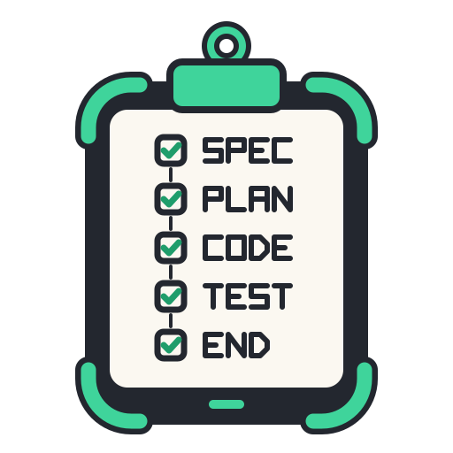
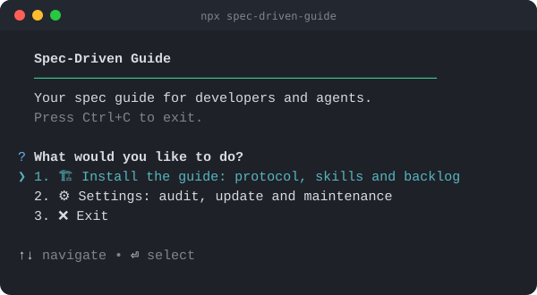

<!-- prettier-ignore-start -->
<div align="center">
  
  <h1 align="center">Spec-Driven Guide</h1>
  <p align="center">
    Seu guia de especificação para desenvolvedores e agentes.<br>
    <a href="README.md">Read in English</a>
  </p>
  <p align="center">
    Leia ao vivo em <a href="https://specdrivenguide.org">specdrivenguide.org</a>
  </p>
  <a href="https://www.npmjs.com/package/spec-driven-guide"></a>
  <a href="https://www.npmjs.com/package/spec-driven-guide"></a>
  <a href="https://github.com/thiagocajadev/spec-driven-guide/actions/workflows/ci.yml"></a>
  <a href="https://nodejs.org"></a>
  <a href="./LICENSE"></a>
  <a href="https://agents.md"></a>
  <a href="CHANGELOG.md"></a>
</div>
<!-- prettier-ignore-end -->

<br>

Spec-Driven Guide (SDG) é um guia para trabalhar com agentes de IA. O `npx spec-driven-guide` instala arquivos de instrução em markdown no seu projeto, e o agente que você já usa (Claude Code, Hermes Agent, Codex, Cursor, Copilot e outros) lê esses arquivos e passa cada tarefa pelas mesmas cinco fases: SPEC, PLAN, CODE, TEST e END. Você toma as decisões, e o agente segue o processo que o guia descreve.

Quem chega ao guia pela primeira vez lê de cima para baixo: Thiago e Cadija mostram o ciclo, e o Início Rápido instala. Quem vai alterar o conjunto de instruções lê a partir de O Que É Instalado, onde cada arquivo gerado é nomeado e apontado para a sua origem.

<!-- prettier-ignore-start -->
<table>
  <tr>
    <td align="center" width="50%">
      <br>
      <strong>Thiago</strong>, o desenvolvedor<br>
      Decide o que será construído e aprova cada passo.
    </td>
    <td align="center" width="50%">
      <br>
      <strong>Cadija</strong>, a agente<br>
      Segue o guia: escreve a spec, planeja, codifica e testa, e para em cada ponto de aprovação.
    </td>
  </tr>
</table>
<!-- prettier-ignore-end -->

<details>
<summary><strong>Conceitos fundamentais</strong></summary>

| Conceito           | O que é                                                                                                                                                                                                                       |
| :----------------- | :---------------------------------------------------------------------------------------------------------------------------------------------------------------------------------------------------------------------------- |
| **Ciclo**          | Uma unidade de trabalho, aberta por um prefixo (`feat:`, `fix:`, `docs:`, `audit:`, `land:`) e fechada por `end:`                                                                                                             |
| **Fase**           | Um dos cinco passos que o ciclo percorre: SPEC, PLAN, CODE, TEST, END                                                                                                                                                         |
| **Onda**           | Num ciclo com um pedido amplo, um grupo de tarefas do PLAN que mexem nos mesmos arquivos, para cada arquivo ser editado uma vez só; cada onda termina com os testes verdes                                                    |
| **Skill**          | Um conjunto de regras sobre um assunto, em `.ai/kit/skills/`, carregado só quando o domínio do ciclo pede                                                                                                                     |
| **Flavor**         | O formato arquitetural do projeto, escolhido na instalação: vertical slice, MVC, lite ou legacy                                                                                                                               |
| **Work Checklist** | Os itens de Form em `code-style.md`: a forma que o código tem desde a primeira linha, conferida em TEST                                                                                                                       |
| **Backlog**        | `.ai/backlog/`, o que você e o agente escrevem sobre este projeto: resumo, stack, padrões, falhas e a fila de tarefas. Versionado, para o time ler                                                                            |
| **Kit**            | `.ai/kit/`, o que o CLI instala: skills, protocolo, comandos e ferramentas. Reescrito a cada instalação e restaurado a partir do manifesto, por isso fica fora do git                                                         |
| **Harness**        | Tudo em volta do modelo: os guias que o orientam antes de agir, os sensores que o conferem depois, e a memória que ele carrega. O SDG é a camada portátil disso; Claude Code, Hermes Agent ou Codex é o runtime onde ele se instala |

</details>

## Um guia, sem burocracia

O SDG é um guia flexível. O protocolo, as fases e as verificações estão nos arquivos de instrução, então você escreve uma linha com um prefixo e o agente conduz o processo. Não há pasta de documentos de spec para manter, nem template para preencher por causa de um typo.

**A spec escala com a demanda. Os gates não.** Um typo rende três linhas; um domínio novo rende um contrato. É esse o equilíbrio que o guia existe para dar: a engenharia que muda o resultado, sem a cerimônia que faz um protocolo ser pulado.

Evite lixo de IA (AI slop): tudo o que o agente escreve tem motivo para existir.

## Comece por um prefixo

Instrua o agente do mesmo jeito que você escreveria uma mensagem de commit.

| Como você pede         | O que você escreve                                                | O que volta                                                                                              |
| :--------------------- | :---------------------------------------------------------------- | :------------------------------------------------------------------------------------------------------- |
| ✅ Um prefixo          | `fix:` login aceita senha vazia                                   | O agente escreve a spec, para para você aprovar, e então planeja, codifica e testa dentro do mesmo ciclo |
| Uma spec escrita à mão | contrato, critérios de aceite e casos de borda, escritos por você | Funciona bem. Detalhe ajuda, e o agente pode escrever esse detalhe junto com você                        |
| ❌ Um pedido solto     | `conserta o login`                                                | O agente adivinha o escopo e começa a escrever. Você descobre o que ele decidiu revisando tudo depois    |

O agente propõe a SPEC a partir do contexto que ele já tem do projeto, e vocês alinham juntos antes de qualquer código. Onde houver risco, detalhe o quanto puder.

## SPEC e PLAN vêm primeiro

<!-- prettier-ignore-start -->
<p align="center">
  
  
</p>
<!-- prettier-ignore-end -->

SPEC e PLAN são as fases de maior peso no ciclo, e as duas acontecem antes de qualquer código.

- **SPEC**: o agente filtra o pedido até o que vai virar uma feature, um sistema ou uma correção. Ele escreve o objetivo, o contrato e o checklist que diz quando o trabalho está pronto, e faz as perguntas que só você pode responder.
- **PLAN**: o agente transforma esse acordo em tarefas pequenas, em ordem, cada uma possível de seguir sozinha.

Nas duas, o agente espera a sua aprovação, então não constrói em cima de um palpite. Sem elas, é mais provável que o agente siga um caminho duvidoso: o agente preenche as lacunas com a própria leitura, e você encontra essa leitura na revisão, depois que o código já existe. Você corrige uma leitura errada pega na SPEC editando um parágrafo.

O hábito também vale fora do código. Um processo de negócio, o lançamento de um produto ou um plano de produção passam pelos mesmos dois passos: combinar o quê e o porquê, e depois os passos em ordem. O que muda é o que vem depois do plano.

## O ciclo como conversa

Um ciclo `feat:`, do jeito que Thiago e Cadija conduzem. Cada ⏸ é uma parada em que a Cadija espera pelo Thiago.

<!-- prettier-ignore-start -->

| Fase | | Mensagem |
| :--- | :-: | :------- |
| |  | `feat: login com Google` |
| SPEC |  | Oi, Thiago! Li o contexto do projeto e escrevi a SPEC: objetivo, contrato e checklist de verificação. Aprova antes de eu planejar? ⏸ |
| |  | Aprovado, Cadija. Pode planejar. |
| PLAN |  | O plano tem três tarefas pequenas, na ordem. Bora pro código? ⏸ |
| |  | Pode seguir. |
| CODE |  | Programando tarefa por tarefa, conforme o plano. |
| TEST |  | Checklist conferido, testes e lint passando. Revisa o resultado? ⏸ |
| |  | `end:` revisei, faz o que combinamos. |
| END |  | Changelog e backlog atualizados. Faço o commit? ⏸ |
| |  | Aprovado, pode commitar. |
| |  | Commit feito. Ciclo fechado, nos vemos na próxima sessão. |

<!-- prettier-ignore-end -->

A mesma conversa roda fase por fase em [specdrivenguide.org](https://specdrivenguide.org).

<details>
<summary><strong>O que o conjunto de instruções cobre</strong></summary>

- **Protocolo de trabalho**: um ciclo de 5 fases (SPEC → PLAN → CODE → TEST → END). Ele traz um **Work Checklist** (itens de forma que o código cumpre, conferidos na fase TEST) e um **Circuit Breaker** (disjuntor · para o agente após 3 tentativas na mesma falha). Você aprova SPEC e PLAN antes de qualquer linha ser escrita, revisa o resultado depois do TEST e aprova o commit. Um pedido amplo é planejado em **waves** (ondas · grupos de tarefas que mexem nos mesmos arquivos), cada uma fechada com os testes verdes.

- **Fresh-context review** (revisão com contexto limpo): antes da parada do TEST, uma mudança `[M]` ou `[L]` passa por um segundo leitor que recebe a SPEC e o diff, mas não a conversa, e reporta separadamente a fidelidade à SPEC e a qualidade do código.

- **Estilo de código e quality gates** (barreiras de qualidade): uma regra só, o `WorkChecklist` em `code-style.md`. Seus itens de Form (forma) são verificados na fase TEST pelas heurísticas de `governance.mjs`. Antes de escrever, a **escada YAGNI** (You Aren't Gonna Need It · você não vai precisar disso) pergunta se o código precisa existir, se o projeto, a biblioteca padrão ou uma dependência já instalada já resolve, e se uma linha basta. Validação nas fronteiras de confiança, tratamento de perda de dados, controles de segurança e acessibilidade nunca são cortados.

- **Skills sob demanda**: cada skill (habilidade · um arquivo de regras sobre um assunto) carrega somente quando o ciclo precisa dela. Há skills para code style, testes, segurança, API, acesso a dados, observabilidade, CI/CD, cloud, SQL, UI/UX, revisão, performance, modelagem de domínio, versionamento e escrita de README.

- **Versionamento como skill**: o `versioning.md` é dono do formato do commit e da tabela que deriva a versão a partir dos tipos de commit, então o número é calculado a partir dos commits em vez de escolhido na mão. Ele também declara os dois modos de release: `derived`, em que a CI calcula a versão e gera o changelog a partir dos corpos dos commits, e `manual`, em que o bump roda localmente e o commit de release carrega o número. A fase END carrega esse arquivo em todo ciclo.

- **Contexto de stack dinâmico**: o ciclo `land:` pergunta o seu stack (o conjunto de linguagens, runtimes e frameworks do projeto) e escreve `.ai/backlog/stack.md`. A fase CODE lê esse arquivo como fonte única de verdade. Não há catálogo de linguagens para manter.

- **Compatível com qualquer agente**: um `AGENTS.md` na raiz do repositório, que Claude Code, Hermes Agent, Codex, Cursor, Copilot, Grok, Windsurf, OpenCode e a maioria dos agentes leem nativamente. Um arquivo escrito por você nunca é sobrescrito.

- **Memória entre sessões**: a pasta `.ai/backlog/` (lista de trabalho e memória do projeto) guarda o resumo, o stack, o estado das tarefas e o conhecimento que o time acumulou. Um **Impact Map** (mapa de impacto) lista os arquivos que o ciclo atual altera, o que os importa e os testes em risco.

- **Catálogo de tooling inerte**: um pacote de ferramentas copiado em `.ai/kit/tooling/`, com nada ligado por padrão. Nenhum `.husky/` criado, nenhuma dependência instalada. Você liga o que quiser, quando quiser. Nele vêm o `git-guard`, um hook que recusa `git push` e `git reset --hard` vindos do agente, e um par `.gitattributes` e `.editorconfig` que concordam no fim de linha. A única escrita fora de `.ai/`: num projeto Node, o `init` adiciona `scripts/bump.mjs` e um script `bump` ao `package.json`, o que `--no-bump` evita.

</details>

---

## Início Rápido

Requer um **Node.js LTS** atual. O mínimo é o `engines.node` do `package.json`, a linha em que o CLI é construído e testado.

```bash
npx spec-driven-guide
```

<p align="left">
  
</p>

O assistente interativo pede o **flavor** (sabor · o padrão estrutural que o projeto segue). O stack vem depois, pelo ciclo `land:`, porque você declara melhor com o projeto já definido.

<details>
<summary><strong>Instalação sem perguntas</strong></summary>

```bash
# Instalação sem prompts (flavor lite + stack.md placeholder)
npx spec-driven-guide init --quick

# Vertical Slice, qualquer stack
npx spec-driven-guide init --flavor vertical-slice

# MVC, qualquer stack
npx spec-driven-guide init --flavor mvc
```

</details>

Depois de instalar, abra o chat do agente e escreva `land: <visão>`. O agente pergunta o stack, escreve `.ai/backlog/stack.md` e monta a primeira lista de tarefas.

---

## O Que É Instalado

O `AGENTS.md` é um roteador e o único arquivo sempre em contexto: ele lista as skills e manda carregar cada uma na hora certa. O `workflow.md` (o protocolo de 5 fases) entra quando um ciclo começa, e o resto só quando o ciclo pede.

Claude Code, Hermes Agent, Codex, Cursor, Copilot e a maioria dos agentes leem o `AGENTS.md` da raiz nativamente, então nada mais é escrito ao lado dele. Os poucos que pedem uma linha de configuração estão em "Usando com outros agentes" abaixo.

> **Clonou um projeto que já usa o SDG?** O `.ai/kit/` não vai para o git. Rode `npx spec-driven-guide restore` uma vez depois do clone: ele reconstrói o kit a partir do manifest versionado, na versão fixada. O `AGENTS.md` diz o mesmo ao agente quando o kit falta.

<details>
<summary><strong>Árvore completa escrita pelo <code>init</code></strong></summary>

```
seu-projeto/
├── AGENTS.md                    ← Ponto de entrada + registro de skills (canônico)
├── .ai/
│   ├── .sdg-manifest.json       ← A versão instalada e um hash por arquivo. Commitado
│   ├── backlog/                 ← Você e o agente escrevem. Commitado
│   │   ├── context.md           ← Resumo do projeto: visão, decisões, estado atual
│   │   ├── stack.md             ← Linguagens, runtimes e versões, declarados pelo `land:`
│   │   ├── learned.md           ← Padrões que deram certo
│   │   ├── troubleshoot.md      ← Falhas e a causa raiz de cada uma
│   │   ├── tasks.md             ← A fila, e o registro do que fechou
│   │   └── session.md           ← Onde este ciclo parou. Fora do git
│   └── kit/                     ← O CLI escreve, e reescreve a cada instalação. Fora do git
│       ├── skills/              ← Habilidades de engenharia, carregadas sob demanda por fase
│       ├── instructions/        ← Protocolo de trabalho, flavor, competência de entrega
│       ├── commands/            ← Comandos de ciclo (feat/fix/docs/audit/land/end)
│       └── tooling/             ← Regras de lint, hooks, scripts de release. Nada ligado por padrão
```

</details>

> Para um detalhamento do papel de cada arquivo, veja [Estrutura do Projeto](docs/reference/PROJECT-STRUCTURE.md).

---

## Como o Protocolo Funciona

Você começa a mensagem com um prefixo, e o agente entra no ciclo correspondente. São prefixos de texto, não slash commands (comandos iniciados por barra, como `/build`): nada é instalado na sua ferramenta.

| Trigger (gatilho)            | Ciclo            | O que acontece                                                                                                               |
| :--------------------------- | :--------------- | :--------------------------------------------------------------------------------------------------------------------------- |
| `land: <sua visão aqui>`     | Primeiro contato | Define a visão e o escopo do projeto antes de escrever a primeira linha                                                      |
| `feat: <descreva a feature>` | Feature          | Percorre SPEC → PLAN → CODE → TEST → END para qualquer funcionalidade nova                                                   |
| `fix: <descreva o problema>` | Correção de bug  | Diagnostica a causa raiz, corrige e confirma que nada mais quebrou                                                           |
| `docs: <o que documentar>`   | Documentação     | Escreve ADRs (Architecture Decision Records · registros de decisão), changelogs e specs técnicas no template certo           |
| `audit: <escopo a auditar>`  | Auditoria        | Verifica se as regras de governança estão aplicadas no projeto e devolve um plano de correção                                |
| `end: <instrução opcional>`  | Fecha o ciclo    | Resume o que foi feito, atualiza o changelog e commita. Também recupera o ciclo se o agente perder o fio no meio da conversa |
| Sem prefixo                  | n/a              | O agente pergunta: "land, feat, fix, docs ou audit?"                                                                         |

O agente **para e espera por você** quatro vezes:

1. Em SPEC, antes de qualquer plano.
2. Em PLAN, antes de qualquer código.
3. Depois do TEST, onde ele relata o que verificou e você resolve os últimos detalhes. O seu `end:` abre o END.
4. Antes do commit, que espera você aprovar a mensagem.

```
  SPEC    o contrato       o que e por quê, escrito       ⏸  você aprova
   │
  PLAN    a estratégia     tarefas em ordem, seguíveis    ⏸  você aprova
   │
  CODE    a execução       o plano, nada além dele
   │
  TEST    a verificação    o feito bate com o combinado   ⏸  você revisa, depois end:
   │
  END     a entrega        changelog, backlog, commit     ⏸  você aprova o commit
```

Para cada fase, suas regras e o diagrama dos pontos de parada e dos loops, veja o [Spec-Driven Guide](docs/concepts/SPEC-DRIVEN-GUIDE.md).

---

## Guardrails

O protocolo protege dez pontos do ciclo, para que você não seja quem pega isso na revisão. A maioria é orientação: texto que o modelo lê e segue. Os demais têm uma checagem fora do modelo que recusa, nomeada na última coluna.

<details>
<summary><strong>Os dez guardrails</strong></summary>

| Guardrail                  | O que evita                                                                                     | Garantido por                                           |
| :------------------------- | :---------------------------------------------------------------------------------------------- | :------------------------------------------------------ |
| **Prefixo obrigatório**    | Um ciclo adivinhado a partir de um pedido solto. Sem prefixo, o agente pergunta qual é          | orientação                                              |
| **Mensagem classificada**  | Um recado no meio do ciclo reabrindo ele em silêncio como um ciclo novo                         | orientação                                              |
| **Assumptions declaradas** | Uma leitura não dita entregue como se fosse o pedido. Onde duas leituras divergem, ele pergunta | orientação                                              |
| **Gates de SPEC e PLAN**   | Código escrito antes de você concordar com o contrato                                           | orientação                                              |
| **Form check**             | Código fora dos padrões chegando à revisão                                                      | check de Code Style do `audit` e as regras do ESLint    |
| **Trava de escopo**        | A refatoração que ninguém pediu, pegando carona no fix                                          | orientação                                              |
| **Blocker à vista**        | Um contorno inventado em silêncio no lugar de uma pergunta feita em voz alta                    | orientação                                              |
| **Circuit Breaker**        | O loop: 3 TESTs falhos, 3 erros iguais, ou 3 turnos sem progresso, e então para                 | orientação; um Stop hook pode limitar continuações      |
| **Gate de commit**         | Um commit que você nunca aprovou, ou um push que ninguém revisou                                | hook `git-guard` e uma permissão `ask`, se configurados |
| **Evidência**              | Uma afirmação sobre o seu código feita de memória, não de um arquivo que ele leu                | orientação                                              |

O `init` não liga o `git-guard` nem a permissão. A receita está em [`tooling/README.md`](src/assets/tooling/README.md), instalado como `.ai/kit/tooling/README.md`.

</details>

**Evidência** é a que mira direto na alucinação: uma afirmação sobre o seu repositório nasce de um arquivo lido nesta sessão e carrega o `file:line`, ou vai marcada como não verificada. Ausente significa não verificado, e "não conferi" é uma resposta barata e válida.

**O que nada disso faz.** Nenhuma instrução impede um modelo de ser confiante. Os guardrails estreitam onde a confiança causa dano e tornam visivelmente irregular a afirmação sem base. O que barra sozinho é mecânico: os testes, o linter, o `audit:`, os hooks.

---

## Flavors Arquiteturais

Escolha o flavor que corresponde à estrutura do seu projeto. Ele diz ao agente em qual camada escrever cada tipo de lógica:

| Flavor           | Padrão                                    | Use quando                          |
| :--------------- | :---------------------------------------- | :---------------------------------- |
| `vertical-slice` | Cortes verticais por funcionalidade       | Monorepo ou API voltada a domínio   |
| `mvc`            | Camadas clássicas (Model-View-Controller) | Serviço REST padrão                 |
| `lite`           | Estrutura mínima, sem camadas             | Scripts, CLIs, utilitários          |
| `legacy`         | Ponte segura para refatorar aos poucos    | Migrando bases de código existentes |

Para o pipeline que cada flavor dá a uma requisição, veja a [Referência Rápida](docs/reference/CHEATSHEET.md#architecture-flavors---flavor).

---

## Declaração de Stack via `land:`

O stack é declarado, não escolhido de um catálogo. Depois do `spec-driven-guide init`, rode o ciclo `land:` para informar as linguagens, os runtimes (tempo de execução · Node, JVM, CLR) e as versões de framework do projeto:

```
land: uma API Node.js + TypeScript servindo um dashboard React
```

O agente pergunta as suas linguagens e versões, classifica cada uma por papel e escreve `.ai/backlog/stack.md`. A fase CODE lê esse arquivo em todo ciclo.

<details>
<summary><strong>O que o ciclo <code>land:</code> faz, passo a passo</strong></summary>

1. Pede que você liste cada linguagem e versão, em texto livre.

2. Classifica cada entrada por papel (Backend / Frontend / Data / Scripts).

3. Oferece buscar a documentação oficial para completar o que faltar. É opcional, e só das fontes listadas em `.ai/kit/commands/sdg-land.md`.

4. Escreve `.ai/backlog/stack.md`. Quando uma versão mudar, edite o arquivo à mão: não precisa gerar nada de novo.

</details>

---

## Usando com outros agentes

O `spec-driven-guide` escreve um único arquivo de governança, o `AGENTS.md`, na raiz do repositório. A maioria dos agentes lê esse arquivo sem passo extra, e o [site do AGENTS.md](https://agents.md) mantém a lista atual.

| Agente         | Lê o `AGENTS.md` | O que saber                                                                                                                      |
| :------------- | :--------------- | :------------------------------------------------------------------------------------------------------------------------------- |
| Claude Code    | nativamente      | Lê enquanto não existe um `CLAUDE.md`. Um `CLAUDE.md` seu precisa de `@AGENTS.md` na primeira linha; o `init` avisa quando falta |
| Hermes Agent   | nativamente      | Carrega um arquivo de contexto do projeto por sessão, e um `.hermes.md` tem prioridade sobre o `AGENTS.md`                       |
| Codex          | nativamente      |                                                                                                                                  |
| Cursor         | nativamente      |                                                                                                                                  |
| GitHub Copilot | nativamente      |                                                                                                                                  |
| Gemini CLI     | uma linha        | `.gemini/settings.json`: `{ "context": { "fileName": "AGENTS.md" } }`                                                            |
| Grok           | nativamente      | O CLI Grok Build, da xAI. Lê o `CLAUDE.md` também, em cada pasta da raiz para baixo                                              |
| Windsurf       | nativamente      |                                                                                                                                  |
| OpenCode       | nativamente      | Lê o `CLAUDE.md` só onde não existe `AGENTS.md`                                                                                  |
| Aider          | uma linha        | `.aider.conf.yml`: `read: AGENTS.md`                                                                                             |

O **OpenRouter** é um gateway de modelos, não um agente. Um agente da tabela rodando um modelo pelo OpenRouter lê o `AGENTS.md` do mesmo jeito.

**Assistentes sempre ligados**, como o Claude Duet e o OpenAI Dots, trabalham fora de um repositório, então o CLI não tem onde instalar. O ciclo continua valendo: peça a SPEC e o PLAN, e aprove os dois antes que eles ajam.

> **Precisa de uma regra que o kit não traz?** Escreva em `## Decisions` no `.ai/backlog/context.md`, que o agente lê no início de toda sessão e nenhuma instalação sobrescreve. Uma edição dentro de `.ai/kit/` se perde na próxima instalação; uma mudança que vale para todo projeto vai para o repositório do kit.

---

## Manutenção

O `npx spec-driven-guide` abre um menu cuja opção **Settings** roda a auditoria de governança.

<details>
<summary><strong>Se preferir, rode direto pelo CLI</strong></summary>

```bash
npx spec-driven-guide gate       # Passar o diff em staged pela barreira (serve como pre-commit, em qualquer linguagem)
npx spec-driven-guide review     # Apontar o drift entre as regras locais e a fonte
npx spec-driven-guide audit      # Rodar a auditoria de governança; sai com erro em qualquer gap
npx spec-driven-guide narrative  # Checar só a narrativa do changelog
npx spec-driven-guide restore    # Reconstruir .ai/kit/ a partir do manifesto commitado
npx spec-driven-guide clear      # Remover o .ai/ e os arquivos de raiz que o CLI escreveu
```

</details>

---

## Referência

Comece pela [Referência Rápida (CHEATSHEET)](docs/reference/CHEATSHEET.md), com todas as flags do CLI e os gatilhos do agente em uma página só.

<details>
<summary><strong>Índice completo da documentação</strong></summary>

- [Estrutura do Projeto](docs/reference/PROJECT-STRUCTURE.md): cada arquivo gerado, quando o agente o lê e quanto custa carregá-lo

- [Spec-Driven Guide](docs/concepts/SPEC-DRIVEN-GUIDE.md): cada fase, suas regras e o diagrama dos pontos de parada e dos loops

- [Roadmap](docs/ROADMAP.md): os marcos entregues, uma major por vez

- [Guias de migração](docs/guides/): um por release com breaking change que pede passos manuais

- [Changelog](CHANGELOG.md): as releases da major atual, com [o arquivo histórico](docs/CHANGELOG-archive.md) guardando todas as anteriores desde a v0.x

- [Créditos e Filosofias](docs/reference/REFERENCES.md): influências do projeto e créditos de pesquisa

</details>

---

## Faça o seu


Ajuste o guia: clone, faça um fork e altere para atender a sua equipe. Contribuições são bem-vindas.

<br clear="right">

> **Aviso:** Este projeto está em desenvolvimento inicial. Revise e ajuste as regras instaladas aos padrões da sua equipe antes de depender delas.

<p align="center">
  <em>“Evite o complexo, prefira o simples e sofisticado.”</em><br>
  <a href="https://thiagocaja.dev"><strong>thiagocaja.dev</strong></a>
</p>
