# Spec-Driven Guide: the five-phase cycle

This page describes the cycle every governed task runs through, phase by phase, and where the agent stops for the developer. It is written for the developer who wants to know what to expect from the agent before typing the first prefix. The rules the agent follows live in [`workflow.md`](../../src/assets/instructions/templates/workflow.md), installed as `.ai/kit/instructions/templates/workflow.md`; this page explains them and does not replace them.

## Fundamental concepts

| Concept             | What it is                                                                                                      |
| :------------------ | :-------------------------------------------------------------------------------------------------------------- |
| **Cycle**           | One unit of work, opened by a prefix (`feat:`, `fix:`, `docs:`, `audit:`, `land:`) and closed by `end:`         |
| **Phase**           | One of the five steps of a cycle: SPEC, PLAN, CODE, TEST, END                                                   |
| **Gate**            | A point where the agent stops and waits for the developer before going on                                       |
| **Wave**            | In a cycle that takes a broad request, a group of PLAN tasks that touch the same files, closed with tests green |
| **Impact map**      | `.ai/backlog/impact-map.md`, the files the plan will touch and what imports them, written at PLAN               |
| **Circuit Breaker** | The rule that stops the agent after three failed attempts instead of letting it loop                            |

## How the model works

The developer sets direction and approves decisions. The agent does the execution: it reads the codebase, proposes a specification and a plan, writes the code and runs the tests. It stops at SPEC and at PLAN for explicit approval, again on the TEST report, where the developer reviews the result and settles the last details, and once more before the commit, which never happens without authorization.

**Spec-Driven Guide (SDG)** keeps the core of spec-driven development: a specification agreed before code exists, and a verification checklist that says when the work is done. It leaves out the apparatus around it. There is no directory of specification files to maintain and no template to fill for a typo. The spec is written in the conversation, at the size the request deserves.

**The spec scales with the demand. The gates do not.** A typo earns three lines of SPEC; a new domain earns a contract, its states and its failure modes. The stop before CODE, the stop before the commit and the verification checklist hold at every size, because a small change nobody approved is still unapproved work.

**SPEC and PLAN carry the most weight.** In SPEC the agent narrows the request down to what will become a feature, a system or a fix; in PLAN it turns that agreement into ordered tasks. You fix a wrong reading caught at either gate by editing a paragraph, before any code depends on it. The same two steps work outside code, in a business process or a production plan, and what changes is what comes after the plan.

---

## Phase SPEC: the contract

The agent defines what will be built and why, and writes no code.

1. **Intent**: the prefix routes the cycle to its command file in `.ai/kit/commands/`. The prefixes are plain message text, not slash commands, so the same protocol works in any harness.
2. **Goal**: one sentence saying what will be built and why.
3. **Domain and contracts**: Backend, Frontend or Fullstack, with the inputs and outputs. A `feat:` models the domain and its contracts first; a `fix:` runs a root cause analysis that names the layer, file and line where the contract breaks.
4. **Verification checklist**: up to five yes/no checks that decide whether the work is done.
5. **Assumptions and questions**: the agent settles every fact the repository can answer by reading it, and states each open reading of the request as a decision taken. Where two readings would produce different work, it asks instead: numbered questions, each with the answer it recommends and why, so the developer can settle them in one line.
6. **Approval gate**: the agent stops until the developer approves.

## Phase PLAN: the strategy

The agent turns the approved SPEC into tasks the developer can follow.

- **Tasks** start with an action verb and run in dependency order.
- **Effort tags**: `[S]` small, `[M]` medium, `[L]` large. Every `[L]` splits into numbered steps (1.1, 1.2).
- **Waves**, for broad requests only: tasks that touch the same files are grouped, so each file is edited once instead of once per item. Waves are lettered (A1, A2, B1), run in dependency order, and each ends with the test command green.
- **Session sync**: the plan goes to `.ai/backlog/session.md`, which is local to the developer. The shared `tasks.md` only receives the outcome, at END.
- **Impact map**: `impact-map.md` lists the files the tasks will touch, then what imports them, the tests at risk and what is safe.
- **Approval gate**: the agent stops until the developer approves.

## Phase CODE: the execution

The agent follows the plan and nothing more.

- **Context load**: `code-style.md` and the skills for the domain the task touches. The Form items of its Work Checklist are what TEST verifies on every changed file, so the code takes that shape from its first line. The language versions come from `.ai/backlog/stack.md`.
- **Plan adherence**: no extra feature and no refactor nobody asked for.
- **Blocker surface**: a blocker is raised as soon as it appears, so the developer, not the agent, decides how to get past it.
- **Delegation**: a subagent taking CODE and TEST gets the approved SPEC and PLAN as written, plus the paths it needs. It never commits and never writes the backlog. `agent-roles.md` holds the handoff.

## Phase TEST: the verification

The agent checks the result against the SPEC, then stops.

- **Checklist**: PASS or FAIL for every item in the verification checklist. On a `fix:`, the reproduction case fails before the fix and passes after it.
- **Test, lint and Form**: the `test` and `lint` commands declared in `context.md`, and the Form items of `code-style.md` on every changed file.
- **Circuit Breaker**: an ordinary obstacle, such as a failing test or a wrong path, is diagnosed and fixed. A deliberate blocker, such as a denied permission, a hook refusal or a decision the SPEC left open, is a stop: the agent asks, because getting around it undoes the reason it exists. The third failed attempt ends with a failure report.
- **Report**: the result per checklist item, plus lint and audit status, grouped by wave when the plan has waves.
- **Review gate**: for an `[M]` or `[L]` change, a fresh-context review runs first: a second reader with the SPEC and the diff, but not the conversation, reports fidelity to the SPEC and code quality apart. Then the agent stops. The developer reads the report and either sends the cycle back to CODE or types `end:`.

## Phase END: the delivery

END runs only on `end:` or an explicit go-ahead.

- **Summary**: one sentence per completed task.
- **Changelog**: depends on the `release` mode in `context.md`. On `manual`, one entry per task under `## [Unreleased]` in `CHANGELOG.md`, following [Keep a Changelog](https://keepachangelog.com/). On `derived`, `CHANGELOG.md` is left alone, because CI generates it from the commit bodies.
- **Backlog sync**: one `[DONE]` entry in `tasks.md`, pruned to the last three. A lesson worth keeping goes to `learned.md`, a failure with its cause to `troubleshoot.md`. `session.md` and `impact-map.md` are reset.
- **Commit**: on `manual`, the `bump` command runs first and the subject carries the version. The agent stages only the files the cycle changed, proposes the message and stops. It never pushes.

---

## The flow, gate by gate

```mermaid
graph TD
    Trigger((Prefixed request)) --> SPEC

    subgraph SPEC [1. SPEC: the contract]
        S1[Intent] --> S2[Goal]
        S2 --> S3[Domain and contracts]
        S3 --> S4[Verification checklist]
        S4 --> S5[Assumptions and questions]
        S5 --> S6{Approval gate}
    end

    S6 -- Approved --> PLAN
    S6 -- Adjust --> SPEC

    subgraph PLAN [2. PLAN: the strategy]
        P1[Tasks and order] --> P2[Effort tags and splits]
        P2 --> P3[Waves, broad requests only]
        P3 --> P4[Session sync]
        P4 --> P5[Impact map]
        P5 --> P6{Approval gate}
    end

    P6 -- Approved --> CODE
    P6 -- Adjust --> PLAN

    subgraph CODE [3. CODE: the execution]
        C1[Context load] --> C2[Plan adherence]
        C2 --> C3[Blocker surface]
    end

    C3 -- Deliberate blocker --> Stop((Stop and ask))
    C3 --> TEST

    subgraph TEST [4. TEST: the verification]
        T1[Checklist] --> T2[Test, lint and Form]
        T2 --> T3{Circuit Breaker}
        T3 -- Pass --> T4[Report]
        T4 --> T5[Fresh-context review, M and L]
    end

    T3 -- Fail, under 3 attempts --> CODE
    T3 -- Third failure --> Stop

    T5 --> Review{Review gate}
    Review -- Adjust --> CODE
    Review -- end: --> END

    subgraph END [5. END: the delivery]
        E1[Summary] --> E2[Changelog by release mode]
        E2 --> E3[Backlog sync]
        E3 --> E4[Version bump, manual mode]
        E4 --> E5[Commit proposal]
        E5 --> E6{Commit gate}
    end

    E6 -- Adjust --> E5
    E6 -- Approved --> Done((Done))

    style S6 fill:#f96,stroke:#333
    style P6 fill:#f96,stroke:#333
    style T3 fill:#f96,stroke:#333
    style Review fill:#f96,stroke:#333
    style E6 fill:#f96,stroke:#333
    style Stop fill:#f66,stroke:#333
```

Diagram of the phases, the gates and the loops between them

`land:` and `audit:` run their own phases and stop before any code; [the quick reference](../reference/CHEATSHEET.md#governance-cycles) draws both.
